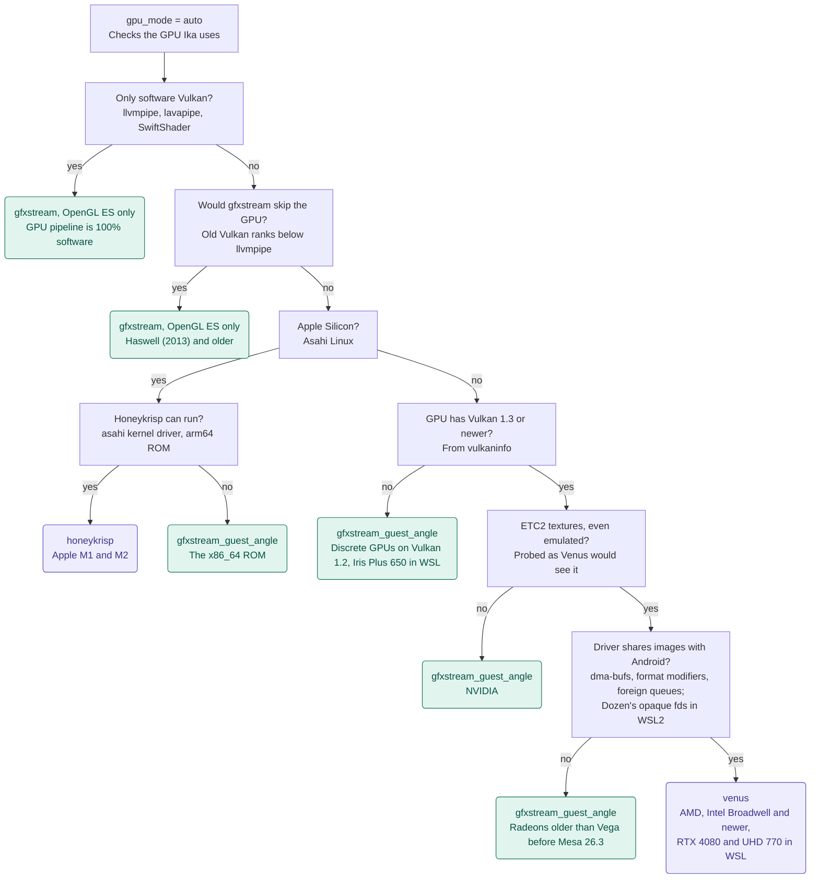
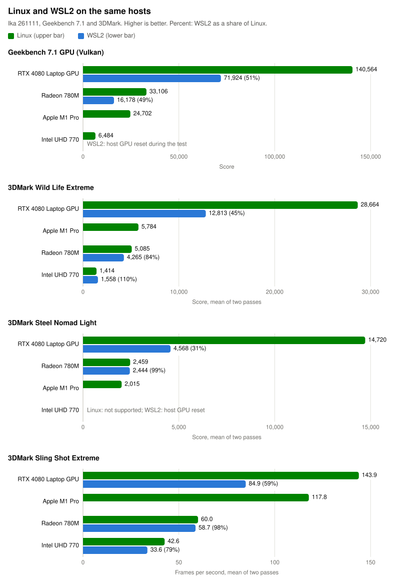

[README](README.md)&nbsp; • &nbsp;[Download](DOWNLOAD.md)&nbsp; • &nbsp;[Using Ika](USAGE.md)&nbsp; • &nbsp;[Configuration](CONFIGURATION.md)&nbsp; • &nbsp;**Graphics**&nbsp; • &nbsp;[Building](BUILDING.md)

# Graphics

Android draws with the host's GPU. Its OpenGL ES and Vulkan calls are encoded in the guest, carried over virtio-gpu by crosvm, and run on the host's drivers by gfxstream, or by virglrenderer in the `venus` mode. This page explains the GPU modes, how Ika chooses one, the switches that tune them, what Apple Silicon needs, and what to do when something looks wrong.

## GPU modes

| Mode | What it does | Use it for |
| --- | --- | --- |
| `gfxstream_guest_angle` | The default where neither `venus` nor `honeykrisp` suits the host (see [How Ika chooses](#how-ika-chooses)). ANGLE in the guest turns OpenGL ES into Vulkan, which gfxstream runs on the host's Vulkan driver | Everything: games, Vulkan apps, the desktop |
| `gfxstream` | gfxstream sends OpenGL ES to its own translator on the host's OpenGL driver; Vulkan is optional | Hosts whose only Vulkan driver is a software one, and titles that render wrongly through ANGLE |
| `guest_swiftshader` | The guest renders on the CPU (ANGLE and SwiftShader) | Ruling out a host GPU problem; turns [low-CPU mode](CONFIGURATION.md#low-cpu-mode) on |
| `guest_lavapipe` | The guest renders on the CPU with Mesa's lavapipe (Vulkan 1.4) and ANGLE | The same, with Vulkan 1.4 instead of SwiftShader's 1.3; turns low-CPU mode on |
| `venus` | The default on a GPU with Vulkan 1.3 or newer and ETC2 textures, whose driver can share images with Android, WSL2's Dozen included. Mesa's Venus Vulkan driver in the guest, over virglrenderer on the host's Vulkan driver, with ANGLE for OpenGL ES | Everything, with less of the host's CPU than gfxstream (see [Venus](#venus)) |
| `honeykrisp` | The default on Apple Silicon, with the arm64 ROM. Mesa's Apple Vulkan driver runs in the guest itself and drives the host's GPU through the asahi kernel driver's virtio-gpu native context, with ANGLE for OpenGL ES | Everything on Apple Silicon; 3DMark runs a little behind `gfxstream_guest_angle` (see [Honeykrisp in the guest](#honeykrisp-in-the-guest)) |

The two gfxstream modes differ in where OpenGL ES is translated:

|  | `gfxstream_guest_angle` | `gfxstream` |
| --- | --- | --- |
| OpenGL ES in the guest | ANGLE | gfxstream's GLES encoder |
| On the host | Vulkan only | OpenGL, and Vulkan when it is on |
| OpenGL ES version | 3.2, or 3.1 where the host's Vulkan driver lacks tessellation shaders (Dozen, under WSL2) | The highest the host's OpenGL ES offers |
| Vulkan in Android | Yes | Only with [Vulkan on](#vulkan-in-gfxstream-mode) |
| Game compatibility | Better | Some games render incorrectly |
| `--gfxstream_vulkan` | Ignored: Vulkan is required | Controls Vulkan |

```text
gfxstream_guest_angle:  app GLES -> ANGLE -> Vulkan -> gfxstream -> host Vulkan driver -> GPU
gfxstream:              app GLES -> gfxstream GLES encoder -> host OpenGL translator -> GPU
```

Cuttlefish accepts other modes too (`gfxstream_guest_angle_host_swiftshader`,
`gfxstream_guest_angle_host_lavapipe`, `drm_virgl`); Ika passes them through
without its own settings and does not test them.

### Vulkan version

Android tells apps the Vulkan version its driver offers
(`android.hardware.vulkan.version`, which Google Play also filters on): 1.4
with `guest_lavapipe`, 1.3 with `guest_swiftshader`, and with
`gfxstream_guest_angle`, `venus`, `honeykrisp` and `gfxstream` with [Vulkan
on](#vulkan-in-gfxstream-mode) the version of the host's first Vulkan device:
1.4 on current RADV, ANV and Honeykrisp, 1.3 on GPUs such as Broadwell's, and
1.1 on a Vulkan 1.2 GPU such as Haswell's, as Android has no 1.2 level. With
OpenGL ES only, Android has no Vulkan driver and declares no Vulkan features.
Ika's ROM installs each guest Vulkan driver as its own package, and the host
tools activate the one the guest loads and select the matching version.

### How Ika chooses

With `gpu_mode` at `auto`, the default, `ika start` looks at the host's
Vulkan devices:

- `gfxstream` when every Vulkan device `vulkaninfo --summary` lists is a
  software one (llvmpipe, lavapipe or SwiftShader), or gfxstream would pick
  llvmpipe over the GPU: it is much lighter on the CPU there. gfxstream ranks
  a device by its type and its Vulkan version, so a GPU with an older Vulkan
  loses to llvmpipe: a Haswell GPU offers Vulkan 1.2, llvmpipe 1.4. In
  `gfxstream` mode that host renders OpenGL ES on its GPU instead; a 1080p
  video that dropped 62% of its frames with `gfxstream_guest_angle` dropped
  1%.
- `honeykrisp` on Apple Silicon, when the GPU is under the asahi kernel
  driver and the ROM ships Mesa's Apple Vulkan driver, as the arm64 ROM does
  (see [Honeykrisp in the guest](#honeykrisp-in-the-guest)); otherwise
  `gfxstream_guest_angle` there, never `venus`: on an M1 Pro games run faster
  with `gfxstream_guest_angle` (see [Venus](#venus)).
- `venus` when the first Vulkan device is a GPU with Vulkan 1.3 or newer and
  ETC2 compressed textures, as Venus's guest sees them. Android expects ETC2
  of a Vulkan device, and Chromium's GPU process quits without it; gfxstream
  emulates ETC2 itself, Venus does not. crosvm starts Venus's host side with
  `vk_require_etc2=true` and `vk_require_astc=true`, which make RADV emulate
  both, so Ika asks `vulkaninfo` with the same settings. Broadwell's driver
  has ETC2 of its own; Haswell's cannot offer it at all. The GPU's driver
  must also have `VK_EXT_external_memory_dma_buf`,
  `VK_EXT_image_drm_format_modifier` and `VK_EXT_queue_family_foreign`,
  through which Venus shares Android's buffers with the host: without them
  Android's Vulkan has no windows, and every app stops as it starts. RADV has
  the second on Radeons older than Vega (an RX 570) from Mesa 26.3 on. Under
  WSL2 the GPU is Dozen's, which Ika's build makes emulate ETC2 and ASTC as
  well, and whose images Venus shares as opaque fds instead (see
  [Venus on WSL2](#venus-on-wsl2)); Dozen offers Vulkan 1.3 only on GPUs with
  shader model 6.6 and wave operations.
- `gfxstream_guest_angle` otherwise.

The checks run in this order, on the GPU Ika uses ("GPU Hardware" in Startup
Options), and the first that answers decides:



`--gpu_mode=` on the command line wins over all three. A mode named in
`gpu_mode` in the `[gpu]` section of `ika.ini` replaces the last two: a host
of the first kind still uses `gfxstream`, and `venus` named there gives way to
`gfxstream_guest_angle` on a host whose driver lacks one of the extensions
above, so an `ika.ini` that moves to another computer with its drive still
starts. `--gpu_mode=auto` makes the choice above for that start, whatever
`ika.ini` names.

```bash
ika restart --gpu_mode=gfxstream
ika restart --gpu_mode=gfxstream_guest_angle
ika restart --gpu_mode=auto
```

The start line says which path Android renders through, and
`~/ika/ikastart.log` logs each choice Ika made, with the reason when `auto`
does not pick `venus` or `honeykrisp`.

## Vulkan in gfxstream mode

`--gfxstream_vulkan=auto|on|off` (`gfxstream_vulkan` in `[gpu]`,
`GFXSTREAM_VULKAN`) decides whether Android has Vulkan in the `gfxstream`
mode. The other modes ignore it.

| Value | Effect |
| --- | --- |
| `auto` (default) | Vulkan stays on, except when the host's first Vulkan device is llvmpipe, or gfxstream would pick llvmpipe over the GPU: then Android has OpenGL ES only, and no Vulkan driver |
| `on` | OpenGL ES and Vulkan |
| `off` | OpenGL ES only, and no Vulkan driver in Android |

A `--gpu_context_types=` option of your own wins over it.

## Host cached memory

`host_cached_memory = on` in `[gpu]` (`--host_cached_memory=on`,
`IKA_HOST_CACHED_MEMORY=on`) changes where the guest's host-visible Vulkan
memory comes from. Android writes its uploads, such as textures and vertex
data, straight into that memory. When the host driver would give it a
write-combined type, which is slow for those writes on some drivers, gfxstream
takes a cached coherent type of the same heap instead (its
`VulkanPreferHostCachedMemory` feature).

It applies to the gfxstream modes, `gfxstream_guest_angle` and `gfxstream`
with Vulkan on; Venus ignores it. It changes a type only where the driver's is
host-visible, uncached and not device-local, and a cached coherent type exists
in the same heap. It changes nothing where every type is device-local, as on
Apple Silicon. Memory shared with a color buffer or a buffer, and dedicated
allocations, keep their type.

It is off by default, as its effect on the Mesa drivers Ika runs on is not
known: try it on yours, for example with GFXBench's offscreen tests in Android
before and after, and keep it if it helps.

On NVIDIA's proprietary Linux driver Ika always turns it on, whatever the
setting says. It began as the fix for text drawn as noise and launcher icons
all alike there; the cause turned out to be KVM ignoring the guest's page
attributes, which crosvm now has KVM honor, and gfxstream draws correctly
without it since. Dozen on an NVIDIA GPU under WSL2 is left as it is.

## Venus

`--gpu_mode=venus` runs Android's Vulkan on Mesa's Venus driver, which sends
the Vulkan calls to virglrenderer on the host and the host's own Vulkan driver,
with ANGLE for OpenGL ES; buffers are allocated through crosvm's cross-domain
context. Ika's ROM has it from Mesa 26.3 on.

```bash
ika restart --gpu_mode=venus
```

On an AMD host (Radeon 780M, RADV) and on an M1 Pro (Honeykrisp) Android
draws its desktop and Chromium's pages, with Vulkan 1.4 and OpenGL ES 3.2
through ANGLE. Apps see every Vulkan device the host has, llvmpipe included,
each named "Virtio-GPU Venus (...)". Upstream tests it on Intel (ANV) and
Qualcomm (Turnip) hosts. Under WSL2 it runs on Dozen; see
[Venus on WSL2](#venus-on-wsl2).

It is the default on a host whose GPU suits it (see
[How Ika chooses](#how-ika-chooses)), but not on Apple Silicon, where games
run faster with `gfxstream_guest_angle`, or on NVIDIA's GPUs, which have no
ETC2. Started with `--gpu_mode=venus` on NVIDIA's own Linux driver (an RTX
4080 Laptop GPU), Android draws its desktop and apps, but apps that render
OpenGL ES through ANGLE get no window, as the driver refuses the swapchain
images ANGLE asks for, and 3DMark stops for want of ASTC textures, which
gfxstream emulates. Against `gfxstream_guest_angle` on a
Radeon 780M, a WebGL page with 12,800 draw calls a frame ran at 60 fps instead
of 24, and crosvm and the render server used about 40% less of the host's CPU,
for WebGL and video alike; a Broadwell MacBook Air was faster with it too. On
Intel's Broadwell and Haswell GPUs ANGLE over Venus offers OpenGL ES 3.1, not
3.2, as their drivers cannot sample ASTC textures; gfxstream emulates them.

A driver without the extensions Venus shares Android's buffers through cannot
run it at all: `--gpu_mode=venus` stops there with the extension it lacks, and
`gpu_mode = venus` in `ika.ini` starts `gfxstream_guest_angle` instead, with
the reason in `~/ika/ikastart.log`. A Radeon RX 570 is such a GPU with RADV from Mesa 26.2, which has no
DRM format modifiers for Radeons older than Vega; with RADV from Mesa 26.3 it
draws Android's desktop, Settings and Chromium.

On an M1 Pro Venus is within 5% of `gfxstream_guest_angle` in 3DMark: Wild
Life Extreme scores 5,551 to 5,580 against 5,809 to 5,845, Steel Nomad Light
1,982 against 2,020, and Sling Shot Extreme's second graphics test runs at
100 fps with either. Both keep the GPU busy for the whole test.

What Ika changes for it:

- crosvm maps Venus's GPU memory into the guest within one region it
  registers at the first mapping (fixed blob mapping), as Asahi's muvm does.
  On arm64 hosts without stage-2 forced write-back, Apple Silicon among them,
  KVM refuses a separate memory slot for each such buffer, so every mapping
  failed there.
- crosvm loads the `libvirglrenderer` of Ika's package, not the system's:
  Debian 13's older one made the guest's Venus driver stop at Vulkan 1.3.
- Where the host driver refuses a raised queue priority, as Honeykrisp does,
  virglrenderer creates the device at medium priority instead of failing:
  SurfaceFlinger asks ANGLE for a high-priority context.
- On Honeykrisp, virglrenderer makes the work an app submits behind a fence
  wait until the work before it has finished. Asahi's kernel driver reports a
  queue's finished work only once the queue has drained, so a frame's fence
  signaled only with the next frame's work, which the app had already
  submitted. Android lets an app draw one frame ahead of that fence, so apps
  drew their frames in pairs with the GPU idle between: Wild Life Extreme
  scored 4,516 instead of 5,551.

## What Ika adds for some hosts

- **AMD (RADV):** in the gfxstream modes, Ika adds `syncshaders` to
  `RADV_DEBUG`, keeping options you set there, so that RADV's asynchronous
  shader compilation cannot run incomplete transform-feedback pipelines. On
  Vega and older GPUs, gfxstream also allocates Vulkan memory as device memory
  only (`VulkanAllocateDeviceMemoryOnly`), against host-visible memory
  corruption. Cuttlefish warns when an AMD host's kernel is older than 6.13.
- **WSL2:** the GPU through Ika's own build of Mesa Dozen, a Vulkan layer and
  a D3D12 shim; see [WSL2](#wsl2).
- **Every host:** the gfxstream modes run with `EGL_PLATFORM=surfaceless`
  unless you set it. `gpu_renderer_features` in `[gpu]` turns gfxstream's
  renderer features on or off; it is empty by default.

## Apple Silicon

### What the host needs

- Fedora Asahi Remix with its 16 KB-page kernel. The kernel must have the
  fix of [AsahiLinux/linux#548](https://github.com/AsahiLinux/linux/pull/548),
  as Fedora's `7.1.6-400.asahi.fc44.aarch64+16k` and later do: without it,
  the GPU keeps the memory Android shared with it until the host reboots.
- Mesa 26.1 or newer, for the Honeykrisp Vulkan driver.
- The `udmabuf` kernel module. `ika-base` enables the
  `cuttlefish-host-resources` service, which loads it at boot and raises its
  limits to 8192 buffers of up to 256 MB. Other values go in
  `/etc/sysconfig/cuttlefish-host-resources` (Fedora, Arch Linux) or
  `/etc/default/cuttlefish-host-resources` (Debian, Ubuntu).

Android boots its 16 KB kernel on 16 KB hosts (`kernel_page_size` in
`[system]`).

### How it works

Honeykrisp has neither `VK_EXT_external_memory_host` nor
`VK_ANDROID_external_memory_android_hardware_buffer`, the extensions gfxstream
normally uses to share host memory with the guest. On Apple Silicon hosts with
16 KB pages, Ika uses the path the Apple GPU supports instead:

- gfxstream allocates the guest's host-visible memory as a sealed memfd,
  wraps it as a DMA-BUF with `/dev/udmabuf` and exports it to crosvm
  (`ExternalBlob` on, `SystemBlob` off, `VulkanAllocateHostVisibleAsUdmabuf`
  and `VulkanUseDedicatedAhbMemoryType` on). These four features take Ika's
  values whatever `gpu_renderer_features` says. Blob sizes follow the host's
  page size.
- crosvm imports those DMA-BUFs through Vulkan, with rutabaga's Vulkano
  gralloc backend, as minigbm has no driver for the Apple GPU. Vulkano starts
  only when minigbm cannot, so other hosts keep minigbm.
- The host display path does not use gfxstream's Vulkan swapchain, which
  would show blank frames with udmabuf memory.
- The console gets each frame as a DMA-BUF: the shown color buffer is
  re-created with an explicit DRM format modifier the first time crosvm
  exports it, which Asahi, radeonsi, iris and NVIDIA all import.
- In the guest, gfxstream's Vulkan driver passes DRM-modifier queries through
  to the host, and keeps the layout of imported hardware buffers across
  `vkCmdPipelineBarrier2` ownership transfers.
- Android gets OpenGL ES 3.2 here too. ANGLE offers geometry and tessellation
  shaders, which 3.2 requires, only if it can count primitives for
  `GL_PRIMITIVES_GENERATED`, and Honeykrisp has no
  `VK_EXT_primitives_generated_query`, so ANGLE would stop at 3.1. When the
  host GPU lacks that extension but has pipeline statistics queries, as
  Honeykrisp does, the host tools turn on ANGLE's
  `allowPipelineStatisticsForPrimitivesGeneratedQuery`, which counts them with
  a pipeline statistics query instead.
- ANGLE in the ROM tells Honeykrisp from Lavapipe, Mesa's software renderer,
  which reports the same vendor and device IDs. Taken for a software renderer,
  the Apple GPU got no `EGL_ANDROID_native_fence_sync` and no multisampled
  render to texture from ANGLE, and none of its tuning for tile-based GPUs.
- gfxstream runs with glibc's `arena_max=4` and `trim_threshold=131072`, to
  keep its memory use down.

`ika start` notes the host's udmabuf count, and `ika stop` compares it with
the count after Android stops: on a leak, it writes a warning to
`~/ika/ikastart.log`. It needs read access to
`/sys/kernel/debug/dma_buf/bufinfo`, or `sudo` without a password.

### Honeykrisp in the guest

`--gpu_mode=honeykrisp` runs Mesa's Apple Vulkan driver, Honeykrisp, inside
Android. Instead of sending Vulkan calls to the host, as gfxstream and Venus
do, the driver itself builds the GPU's command buffers in the guest and sends
only the asahi kernel driver's calls to the host, over a virtio-gpu native
context, the way Asahi Linux's own virtual machines (muvm) work. OpenGL ES
runs through ANGLE on that driver.

```bash
ika restart --gpu_mode=honeykrisp
```

It needs the arm64 ROM, which ships the driver, and an Apple GPU under the
asahi kernel driver. Elsewhere `--gpu_mode=honeykrisp` stops with the reason,
and `gpu_mode = honeykrisp` in `ika.ini` starts `gfxstream_guest_angle`
instead. `gpu_mode = auto` picks it where both are there.

On an M1 Pro Android draws its desktop and apps, Chromium plays VP9 video,
the camera shows its picture, and Asphalt 8 races at its 30 fps. 3DMark runs a
little behind `gfxstream_guest_angle`: Sling Shot Extreme's graphics tests at
115.5 and 96.2 fps against 117.8 and 99.7, Wild Life Extreme 5,543 against
5,800 to 5,845.

How it works:

- crosvm offers the guest a `drm` context beside cross-domain, which still
  allocates Android's buffers. virglrenderer's renderer for Apple GPUs,
  built into `ika-base`'s virglrenderer, runs it in crosvm's GPU process; it
  needs no render server. The GPU's memory maps into the guest as Venus's
  does (fixed blob mapping).
- Honeykrisp has no Android support upstream. Ika's ROM adds it: it takes
  Android's window buffers and hardware buffers, accepts the virtio-gpu
  device crosvm puts on the PCI bus, lists only the queue priorities it
  grants (SurfaceFlinger asks for the highest listed), and gives the graphics
  queue family the second queue Android's UI renderer needs.
- Ika also makes it fast over a native context. Upstream's driver lists every
  shared buffer with every submission, for Linux guests that synchronize
  through the buffers; Android passes fences instead, and the list made each
  submission wait for the one before. Asahi's kernel driver reports a queue's
  finished work only once the queue has drained, so a frame's fence signaled
  only with later frames: the driver now waits, in the guest, for the last
  fence it handed out before it submits more work. And a submission's
  commands go to the host in one virtio request instead of one each.
- Games compile thousands of shaders, and Ika keeps that cheap. Upstream's
  driver keeps every vertex shader's intermediate form (NIR) once it is
  compiled, unless a geometry or tessellation shader follows it, and gives each
  shader's code a GPU buffer of its own: Asphalt 9 held 1.4 GB of NIR and
  10,559 buffers after loading, passed Android's limit of 65,530 memory
  mappings per process and crashed. Ika's driver frees the NIR and places
  shader code in shared 2 MB buffers; the game loads with 1.5 GB and 4,700
  mappings.

Limits: it is tried on an M1 Pro only. The driver lays out a hardware buffer's
planes itself rather than as gralloc reports them; the YUV buffers of Android's
video decoders and of the camera match its layout, but other formats may
not. These changes to Mesa's Apple driver
were written with an AI assistant; Mesa and Asahi Linux do not take such
changes to that driver, so they stay in Ika's ROM
(`external-mesa3d-honeykrisp-android.patch` and the two patches after it in
the series).

## WSL2

On WSL2 the only way to the GPU is Direct3D 12, through `/dev/dxg` and the
libraries in `/usr/lib/wsl/lib`. Mesa's Dozen driver offers it as Vulkan, and
gfxstream renders on that. `ika-base`, in its Debian, RPM and Arch packages,
carries its own Dozen on x86_64, from [Ika's Mesa](#ikas-mesa), installed
under `/usr/lib/cuttlefish-common/wsl/dozen`. It offers Vulkan 1.3 where the
GPU's D3D12 driver has shader model 6.6 and wave operations, and 1.2 on older
GPUs such as Kaby Lake's Iris Plus 650. `gpu_mode = auto` runs Venus on it
where it offers Vulkan 1.3; see [Venus on WSL2](#venus-on-wsl2).

### What the host needs

- KVM in WSL: virtualization on in the firmware, Windows' Virtual Machine
  Platform, `nestedVirtualization=true` under `[wsl2]` in
  `%UserProfile%\.wslconfig`, and, on some AMD hosts, Virtualization-based
  Security off. `ls /dev/kvm` checks it.
- A Windows GPU driver with WSL support. `VK_DRIVER_FILES=/usr/lib/cuttlefish-common/wsl/dozen/dzn_icd.json vulkaninfo --summary`
  lists a `DRIVER_ID_MESA_DOZEN` device named after the GPU.
- The WSL kernel has no udmabuf: set `enable_gpu_udmabuf = false` in `[gpu]`.

### What Ika does

When `/dev/dxg` exists and `vulkaninfo` lists a Dozen GPU, Ika sets, before
choosing the GPU mode:

- `VK_DRIVER_FILES` to Ika's Dozen and Ika's Lavapipe. Lavapipe is there for
  the instance extensions gfxstream needs and Dozen does not list
  (`VK_KHR_external_memory_capabilities` and the like). A `VK_DRIVER_FILES`
  of your own wins.
- `MESA_VK_DEVICE_SELECT=<vendor>:<device>!`, which hides every other device.
  gfxstream would otherwise pick Lavapipe, which supports more of what it
  looks for. A `MESA_VK_DEVICE_SELECT` of your own wins.
- `IKA_DZN_FIX=1`, which turns on the `VK_LAYER_IKA_dzn_fix` Vulkan layer
  ([src/tools/wsl/ika_dzn_fix.c](src/tools/wsl/ika_dzn_fix.c)). It works around
  Dozen's gaps:
  - It works around a crash in Dozen's
    `vkGetPhysicalDeviceImageFormatProperties2`.
  - It offers `VK_EXT_provoking_vertex`, without which ANGLE stops at OpenGL
    ES 2.0. Flat-shaded values come from the first vertex.
  - For Android's Vulkan, it offers `samplerYcbcrConversion`, which
    Chromium's Vulkan backends need, and lists `VK_KHR_sampler_ycbcr_conversion`
    with it: Skia asks a Vulkan 1.1 app's device for the feature only when the
    extension is listed, and in Venus mode SurfaceFlinger, which draws with
    Skia on Vulkan 1.1, aborted on the first frame of a video. The conversion
    is skipped, so YCbCr images are sampled as they are.
  - For Android's Vulkan, it creates images and views of the 4:2:0 YUV formats
    Dozen cannot sample, such as YV12's three-plane one (D3D12 has none), as
    RGBA8, and reports for those formats what an RGBA8 image can do (Dozen
    reports nothing, and Android's Vulkan takes a video buffer's features from
    its format's). Ika's gfxstream and, in Venus mode, crosvm keep such a
    buffer as RGBA8 too, converted from the guest's YUV bytes, so a software
    video decoder's frames show with their colors; SurfaceFlinger aborted on
    them before, restarting Android.
  - It offers `fullDrawIndexUint32` and the full 32-bit index range, which
    D3D12 has but Dozen does not report. Chrome draws with Skia Graphite on
    Dawn, and Dawn's Vulkan backend requires the feature: without it Chrome
    exits at start ("GPU process isn't usable").
  - It pushes push constants again after a switch to another pipeline
    layout. Dozen loses them on that switch, and ANGLE pushes them once per
    render pass, so SurfaceFlinger drew no textures in a frame that began
    with an untextured draw, and the display went black. Ika's Dozen has
    this fix too; the layer keeps it for the distribution's.
  - It keeps gfxstream's ETC2 and ASTC emulation from binding other images
    into a dedicated allocation, which removes the D3D12 device. Ika's
    gfxstream has this fix too.

Ika's gfxstream decodes ASTC textures on the CPU on Dozen, which has no ASTC,
as they are uploaded, instead of with its compute shaders. Those are the main
suspect in GPU hangs on WSL2 (a Radeon 780M, with Asphalt 8 and 9): Windows
reset the GPU, D3D12 removed the device and the whole VM ended. An image whose
ASTC data reaches it some way the CPU cannot decode, such as an image-to-image
copy, is still decoded on the GPU, with an "ASTC image ... decoding it on the
GPU" warning in crosvm's log. The start of the log says which: "ASTC textures
decoded on the CPU (Mesa Dozen)", and each Vulkan device's line has "CPU
decoding:on". The CPU decoder is built for AVX2 (with F16C, POPCNT and
SSE4.1), which the processors of hosts that run Dozen have; on an x86-64 CPU
without them, gfxstream decodes on the GPU and logs "ASTC CPU decoding is
unavailable".

gfxstream's GPU decoder writes those textures as BC3 one array layer at a
time
([PATCH.gfxstream.decompression-layer-views.patch](src/base/cvd/build_external/gfxstream/PATCH.gfxstream.decompression-layer-views.patch)):
Direct3D 12 views a compressed texture as an uncompressed one only a layer
at a time, and removed the device when an app copied into an ASTC cube map.
Where the Direct3D 12 driver has no relaxed format casting (an Intel UHD
770), there is no GPU decoder, and the data the CPU cannot decode stays
undecoded, with a "stays undecoded" warning in crosvm's log
([PATCH.gfxstream.astc-undecoded-no-gpu-decoder.patch](src/base/cvd/build_external/gfxstream/PATCH.gfxstream.astc-undecoded-no-gpu-decoder.patch));
before, gfxstream ran the decoder anyway, and Direct3D 12 removed the device.
- The `libd3d12.so` shim ([src/tools/wsl/d3d12_shim.c](src/tools/wsl/d3d12_shim.c))
  first in `LD_LIBRARY_PATH`. It gives crosvm's Vulkan instances D3D12 devices
  from a pool of a few, which they share. WSL allows about ten D3D12 devices
  per process, and a released device's GPU address space is not given back,
  so after about a hundred Android apps a device per instance runs out. A
  device Windows removed in a GPU reset leaves the pool, so the apps that
  come after get a working one.

Ika's Dozen discards a render-target or depth-stencil texture that is placed
in a heap as its Vulkan layout leaves `UNDEFINED`, on Windows drivers without
D3D12's enhanced barriers, such as the Radeon RX 570's
([dzn-discard-placed-targets.patch](src/tools/mesa/dzn-discard-placed-targets.patch)).
Direct3D 12 leaves such a texture uninitialized until it is cleared, discarded
or copied to as a whole, and Dozen makes every texture an app uploads to one
of them. On the RX 570 a copy to a part of it was lost: Asphalt 9 uploads its
particles' color curves a row at a time, so from the second race on its
particles drew with what the texture's memory held before, as black shapes,
white flashes and blocks of solid color. Drivers with enhanced barriers
discard through those.

Direct3D 12 writes a storage buffer 32 bits at a time at the least, so
Dozen turns a shader's store of a single byte into two atomic operations on
the 32 bits around it, and the invocations that write the other three bytes
wait on each other: on an Iris Plus 650 a compute shader that stores a byte
per invocation, as image filters on 8-bit pixels do, ran 20 times slower or
more than in Intel's own Vulkan driver. When the shader only writes the
buffer, Ika's Dozen gives it a second view, of one-byte elements
(`R8_UINT`), and the shader stores its bytes through that
([dzn-storage-buffer-byte-views.patch](src/tools/mesa/dzn-storage-buffer-byte-views.patch)).
Storing a byte per invocation from 32×8 workgroups became ten times faster
on the Iris Plus 650, about as fast as typed stores are in Intel's own
driver. Bytes stored to a buffer the shader also reads keep the atomic
operations.

Intel's D3D12 driver lays out the invocations of a two- or three-dimensional
compute workgroup, such as 32×8, in an order that suits images, and a
workgroup that works on rows of a buffer then reads and writes several rows
with every instruction. Ika's Dozen declares such a workgroup as one row,
32×8 as 256×1, when the shader uses no image or texture, and works out each
invocation's position in the workgroup itself
([dzn-flatten-buffer-workgroups.patch](src/tools/mesa/dzn-flatten-buffer-workgroups.patch)).
On the Iris Plus 650 a 3×3 filter over an 8-bit buffer in 32×8 workgroups
became four and a half times faster.

On Intel's D3D12 drivers without shader model 6.6, such as the Iris Plus
650's, Ika's Dozen reads and writes storage images in a float, unorm or
snorm format through a second view in the integer format of the same size,
and the shader converts the texels
([dzn-storage-image-int-views.patch](src/tools/mesa/dzn-storage-image-int-views.patch)).
Those drivers load such texels about ten times slower than integer ones, and
in some formats, such as R8G8B8A8_SNORM and R16_UNORM, load zeros. Shaders
that read an image without declaring its format still use the first view.

Ika's Dozen names in its barriers and clears only the depth and stencil
planes an image has
([dzn-depth-stencil-aspects.patch](src/tools/mesa/dzn-depth-stencil-aspects.patch)).
Apps name stencil for a depth-only image, which other Vulkan drivers ignore;
Dozen passed it on, Direct3D 12 refused to close the command list, and
running the list removed the device. Destiny Rising clears its 32-bit depth
shadow map that way, and crashed while loading, with every other app drawing
with the GPU.

Ika's Dozen also leaves out a command buffer whose recording failed, and logs
`dzn: not executing command buffer`
([dzn-skip-failed-cmdbufs.patch](src/tools/mesa/dzn-skip-failed-cmdbufs.patch)).
Direct3D 12 removes the device when it runs a command list it refused to
close, and Venus does not pass `vkEndCommandBuffer`'s error on to the app,
which submits the command buffer anyway: one invalid command took down every
Android app drawing with the GPU, and in the `gfxstream` mode the whole VM.
Now that command buffer's work is lost, and the device stays.

Ika's Dozen creates a color image that is also an input attachment, unless
its memory is imported or exported, as a simultaneous-access texture
([dzn-input-attachment-simultaneous.patch](src/tools/mesa/dzn-input-attachment-simultaneous.patch)).
Games such as Destiny Rising blend in the shader: a subpass reads, as an input
attachment, the image it renders to. Direct3D 12 defines that read only for
simultaneous-access textures; for others the shader can read stale or
compressed data, and Destiny Rising's sky was black on a Radeon 780M. Such
textures are never compressed, which costs some memory bandwidth when the
game renders to them.

Ika's Dozen offers dual-source blending (`dualSrcBlend`), which Direct3D 12
supports with one render target and Dozen kept off
([dzn-dual-src-blend.patch](src/tools/mesa/dzn-dual-src-blend.patch)). A
blend with the `MIN` or `MAX` operation gets `ONE` factors, which these
operations ignore: Direct3D 12 refuses such a pipeline when a factor names
the shader's second output.

Ika's Dozen and its shader compiler also carry conformance fixes from
[Weaselway's Mesa](https://github.com/weaselway/mesa), each found by the
Vulkan conformance tests. Without them, a command buffer that recorded one of
these was lost (`vkEndCommandBuffer` failed), drew the wrong pixels or crashed
Dozen:

- indirect draws with a draw count of 0
  ([dzn-zero-draw-count.patch](src/tools/mesa/dzn-zero-draw-count.patch));
- an empty scissor, which NVIDIA's driver did not clip
  ([dzn-empty-scissor.patch](src/tools/mesa/dzn-empty-scissor.patch));
- copies of part of a depth or stencil plane, and 3D copies with a padded
  `bufferImageHeight`
  ([dzn-copy-regions.patch](src/tools/mesa/dzn-copy-regions.patch));
- clears and resolves through a view of another format
  ([dzn-view-format-clears.patch](src/tools/mesa/dzn-view-format-clears.patch));
- pipeline layouts with null set layouts
  ([dzn-null-set-layouts.patch](src/tools/mesa/dzn-null-set-layouts.patch));
- resolves into a slice of a 3D image, and stencil blits past the first layer
  ([dzn-blit-layers.patch](src/tools/mesa/dzn-blit-layers.patch));
- integer clears of formats with fewer than four channels
  ([dzn-int-clear-channels.patch](src/tools/mesa/dzn-int-clear-channels.patch));
- input attachment usage on formats that cannot be attachments
  ([dzn-input-attachment-formats.patch](src/tools/mesa/dzn-input-attachment-formats.patch));
- the stencil test of render pass subpasses without stencil
  ([dzn-legacy-pass-zsa.patch](src/tools/mesa/dzn-legacy-pass-zsa.patch));
- queries left waiting after a submit failed halfway
  ([dzn-submit-fence.patch](src/tools/mesa/dzn-submit-fence.patch));
- 64-bit float-to-integer conversion on NVIDIA, `isinf` and shared-memory
  atomics on Intel, `OpQuantizeToF16` on vectors and denormal flushing
  ([dxil-conformance.patch](src/tools/mesa/dxil-conformance.patch));
- 16-bit shader types on GPUs without 16-bit shader operations, whose
  drivers refused such shaders
  ([dzn-min-precision.patch](src/tools/mesa/dzn-min-precision.patch)).

Running those tests on an RTX 4080 and a UHD 770 under WSL2 found three more
problems, which Ika's Dozen works around:

- Where the Direct3D 12 driver has no relaxed format casting (the UHD 770), a
  view of a mutable-format image in another format family, such as an
  R8G8B8A8 image seen as R32_UINT, was an invalid call, and Intel's driver
  removed the device for it. Such a view now gets the image's own format: its
  texels are read with the wrong type, but the device stays, and Dozen logs a
  warning once
  ([dzn-mutable-view-family.patch](src/tools/mesa/dzn-mutable-view-family.patch)).
- NVIDIA's driver refuses geometry shaders with 16-bit `mediump` maths, so
  geometry shaders keep it at 32 bits
  ([dzn-gs-mediump32.patch](src/tools/mesa/dzn-gs-mediump32.patch)).
- Intel's driver crashes creating any pipeline with view instancing, so on
  Intel Dozen lowers multiview itself
  ([dzn-intel-no-view-instancing.patch](src/tools/mesa/dzn-intel-no-view-instancing.patch)).

Ika's Dozen makes a view of a compressed texture in an uncompressed format
that covers more than one mip level or array layer, such as a view of all
six faces of a BC3 cube map as 128-bit integers, a null view, which reads
zeros and drops writes, and logs `dzn: Direct3D 12 cannot view`
([dzn-block-texel-view-layers.patch](src/tools/mesa/dzn-block-texel-view-layers.patch)).
Direct3D 12 takes such views one level and one layer at a time, and removed
the device for others; Vulkan allows them.

Ika's Dozen also gives a storage view of one slice of a 3D image, which
OpenGL ES makes for an image unit bound to one layer of a 3D texture, a 3D
view of that slice, as Dozen does for render targets
([dzn-uav-2d-view-of-3d.patch](src/tools/mesa/dzn-uav-2d-view-of-3d.patch)).
Direct3D 12 has no 2D view of a 3D texture and removed the device for one,
which took down the VM on an RTX 4080 and a UHD 770.

Ika's Dozen takes a flat input (a flat-shaded colour, any integer varying)
from the last vertex of a triangle or line when the pipeline asks for it,
as ANGLE does for OpenGL ES
([dzn-provoking-vertex-last.patch](src/tools/mesa/dzn-provoking-vertex-last.patch)).
Dozen advertised that mode but took the first vertex, as Direct3D 12 does,
so such values came from the wrong vertex. On a GPU with barycentrics
support in Direct3D 12 the fragment shader reads them at the last vertex,
except in triangle strips, which still take the first vertex. Intel's
drivers under WSL2 have no barycentrics; there a pipeline whose fragment
shader has flat inputs gets a small geometry shader that copies the last
vertex's flat values to every vertex of each line or triangle, strips and
fans included
([dzn-flat-vertex-gs.patch](src/tools/mesa/dzn-flat-vertex-gs.patch)).

Ika's Dozen copies between a 3D texture and a 2D or array one of a
different but compatible format a slice at a time
([dzn-copy-3d-slices.patch](src/tools/mesa/dzn-copy-3d-slices.patch)),
and on Intel GPUs copies textures of 8-bit formats through a buffer, as
Intel's driver copies them into the wrong texels with Direct3D 12's texture
copy
([dzn-intel-8bit-copies.patch](src/tools/mesa/dzn-intel-8bit-copies.patch)).

Intel's Direct3D 12 driver for a UHD 770 under WSL2 ignores the blend
constant (`glBlendColor`), and writes nothing for a dual-source blend whose
alpha factors take the second source when the blend writes no alpha (alpha
masked out, or a format without alpha). On Intel GPUs Ika's Dozen hands a
blend with the constant to the GPU as a dual-source blend, the fragment
shader writing the constant as its second output, and gives a blend that
writes no alpha plain alpha factors
([dzn-intel-blend.patch](src/tools/mesa/dzn-intel-blend.patch)).
Intel's drivers also leave a depth texture partly stale for the GPU's own
reads after a copy writes it, so shadow maps that an app uploaded came out
with bands of wrong rows. On Intel GPUs Ika's Dozen clears the depth or
stencil plane of a texture before a copy writes it
([dzn-intel-depth-copies.patch](src/tools/mesa/dzn-intel-depth-copies.patch)).
The UHD 770's driver hangs the GPU for good, without resetting it, when a
barrier discards a depth-stencil texture with a stencil plane and several
array layers (a 2D array or cube of D24S8 or D32S8): the app never
finishes, and every app using the GPU in WSL, and `wsl.exe` itself, hang
with it until Windows restarts. On Intel GPUs Ika's Dozen never discards
such a texture
([dzn-intel-ds-array-discard.patch](src/tools/mesa/dzn-intel-ds-array-discard.patch)).
Intel's drivers also copy multisampled depth-stencil textures wrongly
(stencil rows and array layers that keep their old values), so on Intel GPUs
Ika's Dozen copies them with a draw that writes each sample
([dzn-intel-msaa-ds-copies.patch](src/tools/mesa/dzn-intel-msaa-ds-copies.patch)).

The console and app windows draw with OpenGL through Mesa's D3D12 driver
(`GALLIUM_DRIVER=d3d12`), unless you set a `GALLIUM_DRIVER`. Mesa's OpenGL
otherwise falls back to llvmpipe on WSL2, drawing every frame of the window
on the CPU: Zink, OpenGL on Dozen, refuses for lack of robustness2's
`nullDescriptor`. Where Ika found a Dozen GPU, the windows use Ika's own build
of that driver, from Ika's Mesa with
[d3d12-uma-cached-upload.patch](src/tools/mesa/d3d12-uma-cached-upload.patch),
installed with its EGL (`libEGL_mesa` and `libgallium`) under `/usr/lib/cuttlefish-common/wsl/mesa-gl`, which they load
through `__EGL_VENDOR_LIBRARY_FILENAMES`; an EGL vendor file of your own wins.
Distributions' Mesa stages texture uploads in write-combined memory, which
WSL2 maps uncached: writing it ran at 383 MB/s against 13 GB/s for write-back
memory on a Radeon 780M, so each frame of a 1080p video took the window 25 ms
of CPU to upload, 70% of a core in all. Ika's build stages them in
write-back memory on integrated GPUs, where the window takes 14%.

In the `gfxstream` mode, crosvm's own OpenGL, which runs Android's OpenGL ES,
uses the same driver, set up the same way.

The start log has a `WSL2:` line when Ika set this up.

On WSLg the console and app windows also load Ika's build of libdecor's GTK
plugin, which draws their title bar and shadow
([src/tools/wsl/libdecor](src/tools/wsl/libdecor), set through `LIBDECOR_PLUGIN_DIR`
unless you set it). WSLg shows each of those as a window of its own and only
removes it when it is destroyed, while the plugin hides them in fullscreen by
unmapping them: a fullscreen window kept a translucent title bar and frame on
top. Ika's build destroys them instead. It also desynchronizes them from the
window: WSLg did not show a title bar redrawn while it waited for the window's
next frame, so its buttons did not highlight under the pointer.

| Variable | Effect |
| --- | --- |
| `IKA_WSL_GPU_FIX=0` | Ika sets none of the above |
| `IKA_SYSTEM_DOZEN=1` | Uses the distribution's Dozen instead of Ika's |
| `DISABLE_IKA_DZN_FIX=1` | Turns the layer off |
| `IKA_DZN_FAKE_YCBCR=0` | The layer does not offer `samplerYcbcrConversion` |
| `IKA_D3D12_SHIM_DISABLE=1` | The shim creates a device for each instance |
| `IKA_D3D12_DRED=1` | The shim turns on D3D12's DRED. When the device is removed, it logs why, the GPU work in flight and the D3D12 call that removed it, to crosvm's log and `/tmp/ika-dred.log` |
| `IKA_DZN_TRACE_REMOVAL=1` | With `IKA_D3D12_DRED=1`, the layer also logs the first Vulkan call after which the device was removed |
| `IKA_D3D12_CLTRACE=1` | With `IKA_D3D12_DRED=1`, the shim records the D3D12 commands recorded into each command list. When D3D12 refuses to close a list, or running lists removes the device, it logs the list's last 256 commands and the details of its barriers. WSL2 has no D3D12 debug layer, which would otherwise name the rejected command |
| `IKA_ASTC_DECODE=gpu` or `cpu` | gfxstream decodes ASTC textures on the GPU or on the CPU, on any host. Without it, the CPU on Dozen and the GPU elsewhere |
| `DZN_DEBUG=nobc3emulation` | Dozen keeps emulated ASTC and ETC2 textures as RGBA8 instead of BC3 |

### Venus on WSL2

`gpu_mode = auto` runs Venus on Dozen where it offers Vulkan 1.3, and
`gfxstream_guest_angle` on GPUs where it offers 1.2. Dozen shares no memory the CPU sees with another process, as a dma-buf or as
an fd, so Venus runs differently from Linux:

- Cuttlefish starts crosvm without a render server: virglrenderer runs
  Venus's render server as a thread of crosvm (`implicit-render-server`), and
  crosvm maps the memory an app maps into the guest at the address Dozen maps
  it at, without fixed blob mapping.
- Android's buffers are optimal Dozen images, which crosvm's gralloc allocates
  and shares with virglrenderer by opaque fd. The guest cannot map them: the
  display reads each frame back, and minigbm keeps a guest copy of a buffer an
  app also reads or writes with the CPU (screenshots, task snapshots), copied
  from the host when it is locked and back when it is unlocked.
- A software video decoder's YUV frame is an RGBA8 image, as in gfxstream
  mode: D3D12 has no three-plane format and Dozen samples no NV12, so crosvm
  copies the frame from the decoder's guest copy to the GPU, where a compute
  shader converts it, with the same BT.601 colors as gfxstream. Apps that play
  video through Android's decoders (MediaCodec), such as Glimpse, play it;
  Chromium decodes video itself.
- Dozen decodes ETC2 and ASTC textures with Mesa's compute decoders, which
  Cuttlefish turns on for crosvm (`vk_require_etc2`, `vk_require_astc`):
  Android expects both, and 3DMark draws with ASTC. Ika's Dozen keeps ASTC
  and the ETC2 colour formats as BC3, one byte a texel, as gfxstream does,
  instead of RGBA8's four
  ([dzn-bc3-emulation.patch](src/tools/mesa/dzn-bc3-emulation.patch)): a
  compute shader encodes each decoded upload. On an integrated GPU, which
  reads textures from the host's memory, RGBA8 cost Venus its lead over
  gfxstream. GPUs whose D3D12 driver lacks BC textures of any size keep
  RGBA8.
- Apps get OpenGL ES 3.1, not 3.2: Dozen has no tessellation shaders, which
  ANGLE needs for 3.2. Dozen also has no wide points (`largePoints`; a point
  is one pixel whatever size a shader gives it), no custom border colors
  (`GL_EXT_texture_border_clamp`) and no variable pointers, and Venus passes
  on only what the host's driver has.
- Ika's Dozen offers `VK_EXT_queue_family_foreign`, which Venus passes on to
  Android's apps
  ([dzn-queue-family-foreign.patch](src/tools/mesa/dzn-queue-family-foreign.patch)).
  Chromium draws with Skia Graphite on Dawn, and Dawn uses Android's hardware
  buffers only with that extension: without it Chromium exited at every start
  ("GPU process isn't usable"). Dozen already moves an image handed to another
  queue family to D3D12's common layout, which shared resources need, so the
  foreign family works as the external one does.

On an RTX 4080 Laptop GPU, with Ika's console open, Wild Life Extreme scores
17,650 and 16,107 against 14,253 and 13,667 with `gfxstream_guest_angle`.
Steel Nomad Light scores 7,261 and 7,143 against 7,885 and 7,629. Recording an
app's draws takes most of the host's time there, in the D3D12 driver, so
virglrenderer records the command buffers the guest sends on two worker
threads (`VKR_RECORD_THREADS`), as gfxstream does, and submits on a thread of
their own while the next ones are decoded.
On a Radeon 780M Wild Life Extreme scores 4,437 and 4,427 against 4,337 and
4,313 with `gfxstream_guest_angle`, and 3,979 and 3,955 with Dozen's textures
kept as RGBA8 (`DZN_DEBUG=nobc3emulation`); Steel Nomad Light 2,329 against
1,899. The UHD 770 and the Iris Plus 650 score the same with either format.
On an Intel UHD 770 Wild Life Extreme is 5% slower than with
`gfxstream_guest_angle` (1,548 against 1,621). Kaby Lake's Iris Plus 650, with
Vulkan 1.2, runs it when asked for (`--gpu_mode=venus`), slowly. When Windows removes the GPU's D3D12 device, as on the
UHD 770 in Steel Nomad Light in either mode, the app drawing then stops and
Android carries on. On the UHD 770 the GPU hangs on a page fault in the
test's first frames (Windows logs LiveKernelEvent 141 for Intel's driver,
and D3D12 reports `DXGI_ERROR_DEVICE_HUNG`), in a compute dispatch that runs
without fault on its own, with the same shader, images, constants and memory
placement.

### Linux and WSL2 compared

Geekbench 7.1 and 3DMark in Ika 261111, on hosts started once on Linux and
once on Windows with WSL2, each with `gpu_mode = auto`. On Linux `auto` ran
Venus on the Radeon and the Intel GPU and `gfxstream_guest_angle` on the
NVIDIA one; on WSL2 it ran `gfxstream_guest_angle` on Dozen everywhere. The
Intel 12th-gen laptop has the RTX 4080 and the UHD 770, measured one at a time.
The Apple M1 Pro runs Linux only, and ran `gfxstream_guest_angle`.

<picture>
  <source media="(prefers-color-scheme: dark)" srcset="src/docs/linux-vs-wsl-dark.svg">
  
</picture>

In 3DMark the integrated GPUs keep 79% to 110% of their Linux results under
WSL2 and the RTX 4080 31% to 59%; Geekbench's GPU test runs at about half on
the RTX 4080 and the Radeon 780M alike. Sling Shot Extreme on Linux is held
at the display's refresh rate on those two GPUs, 144 and 60 frames per
second, so its share understates the difference. The RTX 4080, the fastest of them, loses the
most in 3DMark: WSL2 adds a cost per draw and per frame, in Dozen's
translation to Direct3D 12 and the trip to the Windows driver.

The UHD 770 has two results missing. Under WSL2, Windows resets the GPU
partway through Geekbench's GPU test and through Steel Nomad Light. On Linux,
3DMark does not support Steel Nomad Light on this GPU.

### Limits on WSL2

- When an app makes Windows reset the GPU, that app ends. If the reset also
  took crosvm's own device, which keeps the display (gfxstream's, or in
  Venus mode the one that allocates Android's buffers and reads its frames
  back), crosvm exits with code 32 and Android restarts, with "VkDevice was
  lost" or "crosvm's Vulkan device was lost" in crosvm's log.
- Each D3D12 device has a 4 GB window for shader-visible descriptor heaps,
  shared by every Android app.
- The GPU device runs in crosvm's second process, the one that maps
  `libvulkan_dzn.so`. crosvm installs its own crash handler, so use `prlimit`
  to get core dumps from it.

## Ika's Mesa

Every Mesa Ika builds comes from the release in
[src/tools/mesa/release.env](src/tools/mesa/release.env), Mesa 26.3.1 for
now: the ROM's guest drivers (gfxstream's Vulkan, Venus and Lavapipe), and in
`ika-base` the host's Lavapipe and, on x86_64, the Dozen and D3D12 OpenGL
drivers for WSL2. The host's GPU drivers stay the distribution's.

The host's Lavapipe is `/usr/lib/cuttlefish-common/bin/libvk_lavapipe.so`,
with `lib64/vulkan.lvp.so` linked to it and its manifest beside it:
`VK_DRIVER_FILES=/usr/lib/cuttlefish-common/bin/vk_lavapipe_icd.json vulkaninfo --summary`
lists it alone. It links LLVM statically, so `ika-base` depends on no LLVM,
except on Arch, which has no static LLVM: there it needs `llvm19-libs`.
The ROM's patches to Mesa are in
[src/lineageos/patches/series](src/lineageos/patches/series), the host's in
[src/tools/mesa/series](src/tools/mesa/series);
[BUILDING.md](BUILDING.md#ikas-mesa) says how to move to another release.

## Known limitations

- **Compressed textures through ANGLE on Apple Silicon:** some titles draw
  their compressed textures as block noise or stripes in gameplay with guest
  ANGLE on Honeykrisp; menus are fine. `--gpu_mode=gfxstream` renders them
  correctly.
- **Lost color buffers:** gfxstream's renderer can lose color buffers when apps
  are restarted repeatedly: screenshots come out magenta or black, or a stale
  frame stays. Restarting Android clears it.
- **Data-buffer hardware buffers:** the `gfxstream` mode cannot create
  `AHardwareBuffer`s used as data buffers; apps that need them work in
  `gfxstream_guest_angle`.
- **Program binaries in `gfxstream` mode:** programs loaded with
  `glProgramBinary` report that they are not linked, so apps compile their
  shaders from source.
- **Host image copy:** `VK_EXT_host_image_copy` is not offered to Android;
  uploads go through staging buffers.
- **Several GPUs:** gfxstream picks the host GPU it scores best (discrete
  before integrated), while Ika's software-driver and RADV checks look at
  `vulkaninfo`'s first device, so on a host with several GPUs the two can
  differ.

[src/lineageos/docs/app-compatibility.md](src/lineageos/docs/app-compatibility.md)
lists how individual games render in each mode.

## Troubleshooting

- **Check what Ika chose:** the start line names the graphics path, and
  `~/ika/ikastart.log` has the GPU decisions: the mode `auto` picked and
  why, Vulkan in `gfxstream` mode,
  the Apple Silicon setup, the RADV settings, host cached memory and the
  reason for low-CPU mode.
- **Logs:** `~/ika/cuttlefish/instances/cvd-1/logs/launcher.log` has
  Cuttlefish's checks and crosvm's and gfxstream's output, with `logcat` and
  `kernel.log` beside it; `cuttlefish_config.json` in the instance folder has
  the settings Android ran with.
- **Vulkan devices:** `vulkaninfo --summary` on the host, and
  `ika adb shell vulkaninfo --summary` in Android.
- **Rule out the host GPU:** `ika restart --gpu_mode=guest_swiftshader`
  renders on the CPU. If the problem goes away, it is in the host's driver or
  in gfxstream.
- **A game renders wrongly:** try the other gfxstream mode,
  `ika restart --gpu_mode=gfxstream`, and back with
  `--gpu_mode=gfxstream_guest_angle`.
- **Black Vulkan surfaces on Apple Silicon:** check that `/dev/udmabuf`
  exists and that `systemctl status cuttlefish-host-resources` is active.

## Where the changes are

- The ROM's patches, guest Mesa included:
  [src/lineageos/patches/README.md](src/lineageos/patches/README.md).
- gfxstream's host patches:
  [src/base/cvd/build_external/gfxstream/gfxstream.MODULE.bazel](src/base/cvd/build_external/gfxstream/gfxstream.MODULE.bazel),
  with a comment for each.
- crosvm's patches:
  [src/base/cvd/build_external/crosvm/README.md](src/base/cvd/build_external/crosvm/README.md).
- virglrenderer's patches and build, Venus and the Apple native context:
  [src/base/cvd/build_external/virglrenderer](src/base/cvd/build_external/virglrenderer).
- Ika's GPU settings: [src/tools/ika-lib/gpu.sh](src/tools/ika-lib/gpu.sh),
  which chooses the GPU mode, and
  [src/tools/ika-lib/gpu-args.sh](src/tools/ika-lib/gpu-args.sh), which passes
  it on to Cuttlefish.
- Ika's Mesa on the host (Lavapipe, Dozen, D3D12 OpenGL), and the Mesa
  version the ROM and the host both build from:
  [src/tools/mesa](src/tools/mesa).
- The WSL2 layer and shim: [src/tools/wsl](src/tools/wsl).
