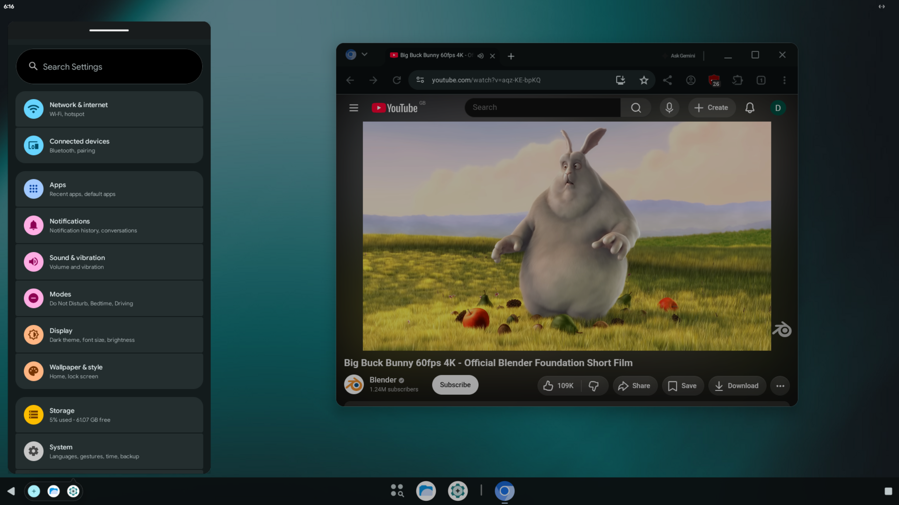
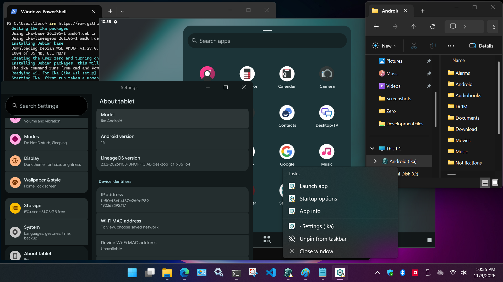

**README**&nbsp; • &nbsp;[Download](DOWNLOAD.md)&nbsp; • &nbsp;[Using Ika](USAGE.md)&nbsp; • &nbsp;[Configuration](CONFIGURATION.md)&nbsp; • &nbsp;[Graphics](GRAPHICS.md)&nbsp; • &nbsp;[Building](BUILDING.md)

&nbsp;&nbsp;&nbsp;&nbsp;&nbsp;&nbsp;&nbsp;&nbsp;&nbsp;&nbsp;

# イカ · Ika Virtual Desktop

**Ika** _/ee-kah/_, Japanese for squid or cuttlefish, is an Android emulator origianlly made for Asahi Linux on Apple Silicon.  Later, support was added for x86-64 and Windows (via WSL).  It's LineageOS 23.2 (Android 16), built as a desktop operating
system, in a [Cuttlefish](https://source.android.com/setup/create/cuttlefish)
virtual machine.

## Features

- **Hybrid Desktop/TV ROM:** Start Android with resizable app windows and a taskbar like GoogleBook OS, or in big-screen TV mode like Google TV.  A guest restart is required to switch between Desktop and TV mode.  Third-party TV launchers are supported.
- **GPU acceleration:** OpenGL ES 3.2 and Vulkan on the host's GPU, through
  gfxstream.
- **The console:** Android's desktop appears in windowed or fullscreen mode on your desktop.  The display follows the window's size at the host's density, pixel for pixel.
- **App windows:** Android apps can open in a window on your desktop, and are automatically added to your desktop's app menu.  They run side-by-side with your native apps.
- **Startup options per app:** Configure app display density, fullscreen mode, the
  keyboard, mouse, gamepad pass-through, gamepad emulation and touch input simulation. Hardware gamepads not supported in WSL 
- **Filesystem auto-mount:** Android's storage is mounted on the host, in the file manager's sidebar on GNOME, KDE, or WSL
- **Camera:** a webcam, or a Mac's FaceTime camera, as Android's camera. Not supported in WSL
- **Backups:** your apps, files and settings, saved and restored with one
  command.
- **Root:** `ika root` roots Android with Magisk.
- **Your choice of Google:** builds with microG, with MindTheGapps (Google
  Play), or with no Google services at all.
- **Broad support:** x86-64 and ARM64, Apple Silicon included, on Fedora,
  Debian, Ubuntu and Arch Linux, in X11 or Wayland sessions.

## Runtime Requirements

- A x86-64 (Sandy Bridge, 2011+) or Apple Silicon (M1/M2, 2020+) computer with hardware virtualization (KVM), and 4 GB of
  memory or more.
- Fedora 44, Debian 13, Ubuntu 26.04 or Arch Linux.  Apple Silicon uses Asahi's 16 KB-page kernel.
- Mesa 26.1 or newer. Debian 13 gets it from
  [trixie-backports](https://backports.debian.org/Instructions/), Ubuntu from
  the [Kisak Mesa PPA](https://launchpad.net/~kisak/+archive/ubuntu/kisak-mesa);
  Fedora and Arch Linux already have this or newer in their base distro packages.
- A GPU with a Vulkan driver for best performance. Without one, Ika renders with the CPU's software driver and runs in a lighter
  [low-CPU mode](CONFIGURATION.md#low-cpu-mode).
- On **x86-64 Windows PCs**, WSL2 and a CPU with nested virtualization support (see [Windows (WSL2)](CONFIGURATION.md#windows-wsl2)).

## Install

1. Download `ika-base` and `ika-lineageos` for your distribution and
   architecture from the [Download](DOWNLOAD.md) page, or
   [build them from source](BUILDING.md).
2. Install `ika-base` and `ika-lineageos` packages:

   ```bash
   # Fedora
   sudo dnf install ./ika-base-*.rpm ./ika-lineageos-*.rpm
   # Debian, Ubuntu
   sudo apt install ./ika-base_*.deb ./ika-lineageos_*.deb
   # Arch Linux
   sudo pacman -U ./ika-base-*.pkg.tar.* ./ika-lineageos-*.pkg.tar.*
   ```

3. **You MUST Reboot after the initial install** The packages add you to the `kvm`,
   `cvdnetwork`, `render` and `video` groups and set up the host's devices and
   limits, which take effect at the next boot; logging out is not enough.
   Updates need no reboot.
4. Start Ika with **Ika Console** located in your desktop's app menu, or with
   `ika start`.

## First steps

- `ika start` boots Android and opens the console, Android's desktop in a
  window. The first start takes longer, as Android sets itself up.
- Your Android apps appear in your desktop's app menu under
  **Android Apps (Ika)**. Each opens in a window of its own; right-click an app to see its **Startup options**.
- `ika stop` stops Android, and `ika help` lists commands.

[Using Ika](USAGE.md) explains the console, app windows, input and gamepads,
TV mode and the everyday commands.

## Documentation

| Page | Contents |
| --- | --- |
| [Using Ika](USAGE.md) | The console, app windows, start options, keyboard, mouse and gamepads, TV mode, files, camera, apps, backups, root |
| [Configuration](CONFIGURATION.md) | Every command and option, `ika.ini`, environment variables, defaults, files |
| [Graphics](GRAPHICS.md) | GPU modes, Vulkan, Apple Silicon, graphics troubleshooting |
| [Building](BUILDING.md) | Building the ROM and the packages from source, on x86-64 and ARM64 |
| [Download](DOWNLOAD.md) | Prebuilt packages |
| [src/lineageos/README.md](src/lineageos/README.md) | The LineageOS Desktop ROM: its products, source layout and build |
| [src/scrcpy/IKA.md](src/scrcpy/IKA.md) | Ika's changes to scrcpy, the console's client |
| [CONTRIBUTING.md](CONTRIBUTING.md) | How to contribute |


