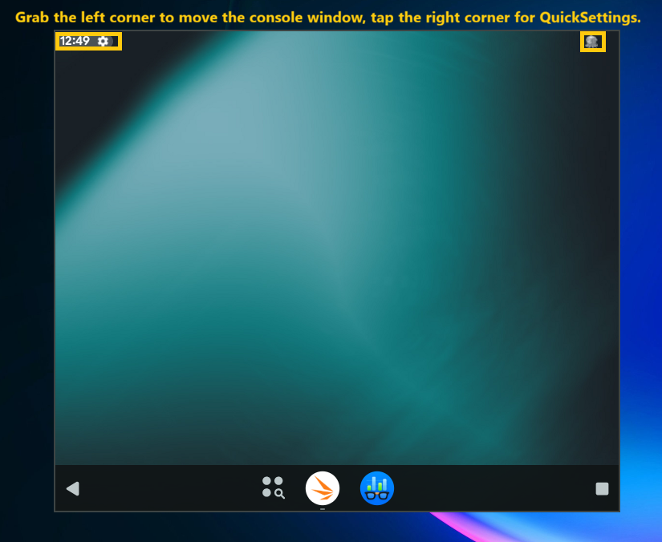

[README](README.md)&nbsp; • &nbsp;[Download](DOWNLOAD.md)&nbsp; • &nbsp;**Using Ika**&nbsp; • &nbsp;[Configuration](CONFIGURATION.md)&nbsp; • &nbsp;[Graphics](GRAPHICS.md)&nbsp; • &nbsp;[Building](BUILDING.md)

# Using Ika

This guide covers the console, Android apps on your desktop, the keyboard,
mouse and gamepads, TV mode and the everyday commands. Each part starts with
what you do on the desktop, then gives the commands that do the same from a
terminal. Every command and setting is listed in
[Configuration](CONFIGURATION.md).

## The console

The console is your Android 16 virtual desktop.  It can be windowed or full-screen.  Its display follows the window size without changing the desktop's density, so resizing the window gives Android more room rather than stretching it.



- **Move it:** drag the top-left corner of the window, where Android shows
  the clock.
- **Drag It** Drag the window corners to resize.  On Linux, drag it to an edge of the screen to fill half of it, or to the
  top to maximize it.  This needs fixing in WSL. 
- **Quick Settings:** click on the cuttlefish at the top-right corner to open QuickSettings and view notifications.
- **Enter/Exit Fullscreen:** MOD+F or F11.
- In fullscreen mode, another way to **exit fullscreen** is to single-click the top-left hot corner. 


MOD is Left Alt or Left Super (Command on a Mac keyboard). The console
remembers its size and whether it was fullscreen.

The mouse works a little differently in Desktop vs. TV mode:

| Button | Desktop mode | TV mode |
| --- | --- | --- |
| Right | Right click | Back |
| Shift + right | Back | Right click |
| Middle | Home | Home |
| 4th, 5th | Recent apps, notifications (twice: quick settings) | The same |

Shortcuts, with MOD held:

| Keys | Action |
| --- | --- |
| MOD+F | Fullscreen on and off |
| MOD+Q | Close the window |
| MOD+H, MOD+B (or MOD+Backspace), MOD+S | Home, Back, recent apps |
| MOD+N, MOD+Shift+N | Open (twice: quick settings), close the notification panel |
| MOD+Up, MOD+Down, MOD+P | Volume up, down, power |
| MOD+C, MOD+X, MOD+V | Copy, cut, paste through Android's clipboard |
| MOD+Shift+V | Type the clipboard's text |
| MOD+O, MOD+Shift+O | Turn Android's screen off, on |

A keyboard's special keys go to Android too, when the console or an app
window gets them:

- Volume Up, Volume Down, Mute and the media keys (Play/Pause, Next, Previous,
  Stop, Fast Forward, Rewind, Record, Eject)
- F1 to F10 and F12 (F11 is the console's fullscreen key)
- Print Screen, which takes an Android screenshot, the Menu key, Insert,
  Pause, Caps Lock, Num Lock, Scroll Lock, Cut, Copy, Paste and Help
- the browser keys: Back, Forward, Home, Refresh, Search and Bookmarks
- Power, Sleep and Wake, which turn Android's screen off and on

GNOME and KDE Plasma keep many of them for the computer (its volume, players,
screenshots and power), so those reach Android where no desktop takes them,
such as [a session that runs only Ika](#a-session-with-only-ika). Keys the
console has no name for, such as brightness, the keyboard backlight, Mail and
Calculator, do not reach Android. A window with **Send the keyboard straight
to Android** ticked passes a standard keyboard's keys only, without the
volume, media, browser and power keys.

Holding Ctrl or Shift as you press the left button adds a second finger,
which mirrors the pointer until you let go:

- **Ctrl+drag:** pinches and rotates about the center of the screen.
- **Shift+drag:** slides two fingers up and down together.
- **Ctrl+Shift+drag:** slides two fingers left and right together.

Drop an APK on the window to install it; any other file dropped there goes to
Android's Download folder. This is not supported on WSL: Windows cannot drag
files into WSL's windows, so install APKs there with `ika install` (see
[Installing and removing apps](#installing-and-removing-apps)).

## Starting and stopping

The **Ika Console** icon in your desktop's app menu starts Android and opens
the console.  Right-click the icon for **Start Ika**, **Stop Ika**, **Restart Ika** and
**Startup options**; on WSL, right-click its button on the Windows task bar.

**Startup options** (`ika options` in a terminal) opens **Startup Options ·
Ika**, a window like an app's, for the settings of `ika.ini` you change most, in two tabs:

- **Startup Options**: **CPUs** and **RAM** (`cpus`, `memory_mb`), the
  console's **Desktop display density** and **TV display density** (`dpi`,
  `tv_dpi`) and its **Refresh rate** (`refresh_rate_hz`), each 0 for auto;
  the **GPU mode**, named as in `ika.ini` (**Auto**, `auto`, the default,
  which Ika resolves for the host, `gfxstream_guest_angle`, `gfxstream`,
  `venus`, `guest_swiftshader` and `guest_lavapipe`; **gfxstream, OpenGL ES**
  is `gpu_mode = gfxstream` with `gfxstream_vulkan = off`, and **Auto** or
  **gfxstream** chosen from another mode sets `gfxstream_vulkan = auto`),
  **Hardware video decoding** and **Low-CPU
  mode**; **Start with the camera** (`device` in `[camera]`, see
  [Camera](#camera)); and **Enable gamepad emulation in TV mode**
  (`tv_keyboard_gamepad`). Low-CPU mode runs the display at its own 30 Hz
  whatever the refresh rate says.
- **Gamepad Emulation**: the keyboard gamepad of `[keyboard_gamepad]`, as an
  app's tab shows it (see [Controller mapping per game](#controller-mapping-per-game)),
  which TV mode and the apps without a mapping of their own use.

**Apply settings** writes the settings you changed in `ika.ini`, each in place
of its line, so that the rest of the file stays as it is; they apply the next
time Ika starts. **Apply and restart** also restarts Ika. **Reset to default**
asks first, then writes the built-in value of each, and **Cancel** leaves the
file as it was.

From a terminal:

```bash
ika start      # boot Android and open the console, as the icon does
ika status     # is it running?
ika stop       # stop Android
ika restart    # stop and start again, with new options if given
```

- `ika start -f` opens the console fullscreen, and `ika start --no-console`
  starts Android without it; app windows open either way.
- `ika start` while Android runs reopens the console.
- **Updating the ROM:** a new `ika-lineageos` would make Cuttlefish rebuild
  Android's disk and discard its data, so `ika start` refuses to start after
  one and says so. Run `ika backup` before installing it, then `ika reset` and
  `ika restore` after (see [Factory reset](CONFIGURATION.md#factory-reset)).

### A session with only Ika

The login screen (GDM, SDDM and others) lists **Android** next to your desktops.
The session runs in [Cage](https://github.com/cage-kiosk/cage), which `ika-base`
requires, so the package manager installs it with Ika. Log in with **Android** and
Android fills the screen, with no desktop around it: the keyboard's special
keys (see [The console](#the-console)) reach Android, and no desktop shortcut
takes one first.

- Closing the console (MOD+Q), or turning Android off from its power menu,
  logs out and stops Android. An Android already running, from a desktop
  session, keeps running, and its console moves to the Android session.
- The Power and Sleep keys turn Android's screen off and on, not the
  computer: the session holds them back from the system while it runs.
  Closing a laptop's lid still does what the system is set to do.
- Ctrl+Alt+F1 to F12 still switch to other virtual terminals, a way out to
  another session or a text login.
- If Ika cannot start, a window says why before you are logged out;
  `~/ika/ikastart.log` and `~/ika/session.log` have the details.
- To make the PC start straight into Android, log in automatically with the
  **Android** session. GDM logs in with the session you chose last, so log in
  with **Android** once, then turn on automatic login (GNOME's Settings, Users).
  SDDM takes `User=` and `Session=ika` under `[Autologin]` in a file in
  `/etc/sddm.conf.d/`.
- App windows belong to a desktop: the Android session shows the console only.
- WSL has no login screen; on Windows, start Ika as usual.

## Android apps on your desktop

### The app menu

While Android runs, Ika lists every Android app in your desktop's app menu,
in an **Android Apps (Ika)** group: a folder in GNOME's app grid, a submenu
on KDE Plasma, XFCE, Cinnamon and MATE, or a Start Menu entry on Windows. Games are prefixed with a joystick icon and "🎮 ∙ MyGame" and apps have a dotted prefix "∙ MyApp" to better separate them from Windows icons, like "Settings".

- **Open an app** from its menu entry: it opens in a window of its own. This
  works while Ika is stopped too: Android starts without the console, and the
  app opens once it has booted.
- **The menu follows Android:** a watcher adds, updates and removes entries as
  apps are installed, updated, removed, enabled or disabled, checking every
  5 seconds (`menu_poll_sec` in `ika.ini`). Its log is `~/ika/app-menu.log`.
- **Games** are the apps that declare themselves games, and the ones listed in
  `game_apps` in `ika.ini`. A game starts with **Fullscreen mode** and
  **Send the keyboard straight to Android** ticked in its start options the
  first time it is added to the menu.
- **Hidden apps:** Android Switch, the Google search app, Calculator,
  Calendar, Clock, Contacts, Recorder and AudioFX stay out of the menu and of
  `ika app` (`hidden_apps` in `ika.ini`). They still open by package name.
- `ika app sync` updates the menu at once. `ika app sync --remove` removes
  the entries and the group, and keeps them off until `ika app sync` runs
  again. `ika reset` removes them too; the next `ika start` puts them back.

The entries are `~/.local/share/applications/ika-PACKAGE.desktop` files. Each
sync rewrites the parts Ika manages, such as the name, the icon and the
actions; lines you add yourself, such as `NoDisplay=true`, stay when
`desktop-file-edit` is installed.

### App windows

An app opened from the app menu gets a window of its own, with a title bar,
the app's label and icon, and a display of its own, sized to the window, so
the app has the window's room. The app is restarted on that display if it was
running elsewhere.

On Windows (WSL), the title bar has Windows 11 native appearance with minimize,
maximize, and close buttons in the color of the app's content. It is sized
for Windows' display scale as the window opens: after changing the scale,
close the window and open it again.

- **Size:** 60% of the screen's width at 16:9 the first time, then the size
  you left it at.
- **Closing:** closing the window, MOD+Q or `ika app close` closes the app,
  and so does the app ending. App windows also close when Android restarts or
  stops (`ika stop`, `ika restart`, `ika reset`, a switch to TV mode);
  `ika start` leaves them open.
- MOD+F and a click in the top-left corner work as in the console. The
  mouse's buttons all go to the app, except Shift + right click, which is
  Back.

From a terminal:

```bash
ika app                  # list the apps; open windows are in bold
ika app Asphalt 8        # open an app in its own window
ika app com.android.settings
ika app close Asphalt 8  # close one window
ika app close --all
```

- **Naming apps:** by package name or by label, without regard to case,
  exactly or by a part only one app has (`ika app setti` opens Settings),
  without quotes. A name that matches several apps lists them.
- **Size and title:** `--size=WxH` and `--title=TEXT` set them, and `-f`
  opens the window fullscreen.

### Games in the background

Opening a game sends the other games with open windows to the background,
so that one game runs at a time:

- Their windows close, but each game stays on its own display, out of the
  console's way. The display is turned off, so Android stops the game, as
  when a phone's screen goes off, without ending it.
- Opening the game again, from the menu or with `ika app`, turns its display
  back on in a new window, and the game goes on where it left off instead of
  starting anew.
- `ika app` marks games in the background "(background)". `ika app close
  NAME` ends one, `ika app close --all` ends them with the windows, and
  `ika stop`, `ika restart`, `ika reset` and a switch to TV mode end them all.
- Apps that are not games keep their windows, and opening one does not touch
  the games. Android can still end a game in the background when it needs the
  memory; it then starts anew when opened.
- `background_games = false` in the `[apps]` section of `ika.ini`, or
  `IKA_BACKGROUND_GAMES=false`, leaves the other games' windows open.

### Right-click actions

Right-click an app in the menu for:

- **Launch app**: opens the app, as clicking it does. An app has one window,
  so GNOME's **New Window** is not offered.
- **Startup options**: how the app starts (below), and its keyboard
  gamepad keys (see
  [Controller mapping per game](#controller-mapping-per-game)).
- **App info**: Android's App info page for the app, alone in
  a Settings window, for its permissions, storage, notifications, force stop
  and uninstall. `ika app --info NAME` from a terminal.

WSL right-click actions won't appear unil you open the app once.  Pin the icon to your taskbar and the right-click menu will be available.  Alternativly, hold **Shift** while double-clicking a console or app and its **Startup options** will appear instead.

### Start options

**Startup options** (`ika app --options NAME`) opens a window,
**Startup Options · APP**. **Display density, 0=Auto** sets the density of
the app's window: 0 is the console's, as without it, else 96 to 999 DPI (a
number under 96 is taken as 96). A checkbox follows for each way the app can
start:

| Option | Effect |
| --- | --- |
| **Fullscreen mode (F11, Cmd+F or Left-Alt+F exits)** | The window opens fullscreen; F11, MOD+F or a quick click in its top-left corner leaves it |
| **Send the keyboard straight to Android (many games need this)** | Keys reach the app as from a physical keyboard, a HID device of Android's |
| **Send the mouse straight to Android (Cmd or Left-Alt releases pointer)** | The mouse is a physical mouse of Android's, and the window captures the pointer: tap Cmd (Left Super, the Windows key on other keyboards) or Left Alt to release it, click in the window to capture it again |
| **Use gamepads, including ones plugged in later** | The host's gamepads, and ones plugged in later, reach Android |
| **Keyboard as a gamepad (keys on the Gamepad Emulation tab)** | The keyboard and mouse drive a gamepad (see [Keyboard as a gamepad](#keyboard-as-a-gamepad)) |
| **Mouse as touch: clicks tap, drags swipe** | See [Touch input](#touch-input) |

**Apply settings** saves the density and the ticked options, **Apply and
start** saves them and opens the app, and **Cancel** (or Escape) leaves them
as they were. They apply every time the app opens, from the menu or with
`ika app NAME`, which adds the options you type to them; `ika app NAME
--dpi=N` opens it at another density once (`--dpi=auto` at the console's).
They are saved in `~/ika/app-options.ini`. 

## Keyboard, mouse and gamepads

### Passing devices through

The console types with Android's text input. An app window can pass the
keyboard, the mouse and gamepads through instead, as if they were plugged
into Android, with its [start options](#start-options).

A window with the mouse passed through captures the pointer. Tap MOD (Left
Alt or Left Super) to release it; a click in the window captures it again, as
does tapping MOD. MOD never reaches Android; Right Alt does.

Every gamepad Android sees, physical or the keyboard's, is a device named
**Ika Emulated GamePad** (`ika adb shell dumpsys input` lists them), with the
vendor and product IDs of an Xbox 360 controller (045e:028e), which gives
Android its key layout and games the mapping they know. A window's gamepads,
the keyboard gamepad and the host's real ones, each a gamepad of its own,
are connected only while the window has the focus: a game in the background
has none, and they connect again when you click back into its window.  **Note, Ika on WSL does not support physical game contollers**

### Touch input

With **Mouse as touch** ticked, or `ika app NAME --touch`, left clicks and drags
reach Android as a finger on a touchscreen, so a drag is a swipe, for games
that ignore the mouse. The right and middle buttons and the wheel stay mouse
input, Ctrl or Shift with the left button still pinch, and no hover is sent.
Touch input wins over passing the mouse through; the keyboard and gamepads
still pass through when ticked. Most other apps are better without it: some
handle mouse clicks differently from touches, such as Chromium's tab strip.

### Keyboard as a gamepad

With **Keyboard as a gamepad** ticked, the keyboard and the
mouse drive a gamepad of Android's, and gamepads plugged into the host pass
through as well. The keys it uses no longer type; other keys do.

| Keys | Gamepad |
| --- | --- |
| W, A, S, D | Left stick |
| Arrows | D-pad |
| I, J, K, L | Right stick |
| Space, Esc, C, V | A, B, X, Y |
| Enter, Backspace | Start, Back |
| Q, E | Left and right shoulders |
| Z, X | Left and right triggers |
| Left Shift, F | Left and right stick clicks |
| Tab, held | Walk (**Hold to walk** in the window): the sticks go half as far |
| Mouse motion, with `mouse_stick = right` | Right stick, the camera in most games: the faster the mouse moves, the farther |
| Left, right button | Right, left trigger, crossed as in PC shooters: a left click fires (the right trigger) and a right click aims (the left) |
| Middle button | Right stick click |
| Wheel up, down | Left, right shoulder |

By default (`mouse_stick = off`, **Mouse → Analog stick: Off** in a
game's controller mapping), the mouse is not the gamepad's at all, its
buttons and wheel included, and the pointer stays free. With the mouse on a
stick (`right` or `left`, **Right stick** or **Left stick**), its buttons and
wheel are the gamepad's as above, and the window captures the pointer: tap
MOD to release it, and the mouse works as usual; tap MOD again to take it
back. Keys pressed with Ctrl,
Alt or Super type instead.

It plays like a physical pad. The sticks and the D-pad are separate, a stick
on a diagonal goes as far as on an axis, and of two opposite directions only
the last pressed counts. A key pushes a stick as a thumb does, over 100 ms,
so a tap moves it a little and a held key all the way, and it comes back at
once. Keys are physical positions, as on a US keyboard: on AZERTY, `W` is the
key marked Z.

The keys and these behaviors are set in the `[keyboard_gamepad]` section of
`ika.ini`; [Configuration](CONFIGURATION.md#keyboard_gamepad) lists every
control and setting. A key you give a control there is taken from the control
it is a default of, so moving a key takes one line:

```ini
[keyboard_gamepad]
a = Space Return
left_trigger = Left_Shift
```

### Controller mapping per game

The **Gamepad Emulation** tab of an app's **Startup options** window
(`ika app --controller NAME` opens the window on it) has the
keyboard gamepad's settings for that game: a field per control, with its
keys, and **Full tilt, ms** (how long a stick takes to go where a key
pushes it), the walk speed, what two opposite directions held together do
(**Opposite directions**: **Last pressed wins**, or **Cancel out**, as
fighting games expect), which stick the mouse moves, and the mouse's
sensitivity. **Guide (Home)** is the pad's middle button: Android passes
it to the app as `BUTTON_MODE`, and goes Home when the app does not use it,
as few games do, so it has no key unless you give it one. Back and B go
back in the same way: Android takes them as its Back when the app does not
use them, so Backspace and Escape go back too with the keyboard as a
gamepad. The fields follow the hands: the left column has the left
half of the pad (the left stick and its click, the D-pad, the left shoulder
and trigger, Back), then the walk key with the walk speed under it, and the
sticks' other settings; the right column the right half (A, B, X, Y, the right stick and its click, the right
shoulder and trigger, Start), then Guide and the mouse's settings.

- **Apply settings** saves an edited mapping in
  `~/ika/apps/PACKAGE/controller.ini`, and ticks **Keyboard as a gamepad** in
  the app's start options, unless you unticked it in the window. A mapping left as shown is saved only when the game already has
  one of its own, so the game keeps following `[keyboard_gamepad]`.
- **Apply and start** saves them and starts the game.
- **Reset to default** asks first (**Apply defaults to APP**, **Ok** or
  **Cancel**), then resets the app's start options, a game's to **Fullscreen
  mode** and **Send the keyboard straight to Android** at the console's
  density, and deletes the game's mapping, so the
  game uses `[keyboard_gamepad]` again; the window comes back on the
  **Startup Options** tab with both.
- **Cancel** leaves everything as it was.

A key typed for one control is taken from the control it was shown on. The
saved mapping holds every key and setting, so later changes to
`[keyboard_gamepad]` reach the game only after **Reset to default**. The
per-pad `socd_dpad`, `socd_left_stick` and `socd_right_stick` settings are not
in the window; write them in the file by hand.

### Console arguments and logs

The console and app windows are scrcpy windows. `scrcpy_args` in `[console]`
of `ika.ini`, or `--ika_scrcpy=`, gives them extra scrcpy options; a
`--gamepad=` or `--gamekb` option there wins over the start options.

The console's input setup is logged in `~/ika/ikastart.log`. An app window's
log is `~/ika/apps/PACKAGE/window.log`, where the keyboard gamepad reports
keys it does not know.

## TV mode

Android has a TV interface as well as the desktop one. **Desktop/TV** changes
the mode: open it from the desktop's **Android Apps (Ika)** menu, where it
opens in a window of its own, from Android's app drawer in desktop mode, or
from the TV launcher's apps in TV mode. It lists **Trebuchet**, the desktop's
launcher, under **Desktop mode**, and each TV launcher installed under **TV
mode**, **Catapult** (LineageOS's TV launcher) first:

- In TV mode, choosing another TV launcher makes it the Home app and opens it
  at once.
- Changing the mode asks first. **Restart** switches Android's Settings,
  on-screen keyboard, launcher and Google Play Store to the other mode's, and
  restarts Android in it, with only a spinning circle in the window
  meanwhile; **Cancel** keeps the mode. If the Play Store cannot be switched,
  the mode stays as it was.
- When Android has restarted, the console reopens in the new mode, and app
  windows close.

### TV mode compared with desktop mode

|  | Desktop mode | TV mode |
| --- | --- | --- |
| Console | Windowed or fullscreen, as asked | Fullscreen at every `ika start`, and as it was after Android restarts; MOD+F or a click in its top-left corner leaves it. Its windowed size is kept apart from the desktop console's |
| Interface size | The density from the host display (`dpi`) | 1.5 times that, so everything is 50% larger (`tv_dpi`) |
| Right click | Right click; Shift + right click is Back | Back, as a remote's; Shift + right click is a right click |
| Gamepad | Not passed through to the console | The remote: the D-pad or left stick moves, A selects, B goes back, the guide button goes Home; a gamepad plugged in later is picked up |
| Keyboard | Typed as text | The same |
| Home app | Trebuchet, with its taskbar | The TV launcher chosen in Desktop/TV |
| Home key | Home | Home; pressed twice, recent apps |
| System UI | Status bar, taskbar, navigation bar, notification shade | Android TV's: its notification panel, picture-in-picture and volume controls |
| Apps in Android | Desktop windows, split screen | Fullscreen only |
| App windows | Their own windows, at the console's density | Still their own windows, at the desktop mode's density |
| Settings | Settings | TV Settings |
| On-screen keyboard | The desktop's | The Leanback keyboard |
| Google Play Store | The phone build | The Android TV build; on x86-64 hosts the ARM64 build, through Android's ARM translation |
| What apps see | A tablet | An Android TV that runs TV apps, with a touchscreen |
| Recent apps at startup | Cleared, so that the desktop does not reopen their windows | Kept |

- **Interface size:** `tv_dpi = auto` is 1.5 times the density `dpi = auto`
  gives, rounded down to a multiple of 8; a number sets it. `--dpi` on
  `ika start` or `ika restart` sets the console's density in either mode.
  App windows use `dpi` from `ika.ini` in both modes.
- **What apps see:** in TV mode Android has the leanback, leanback-only and
  live TV features and the television UI mode, so apps with a TV version show
  it. Google Play may hide apps without TV support, and show phone apps you
  installed in desktop mode as incompatible; they still run. Unlike a TV, Ika
  keeps its touchscreen, for the desktop's apps.
- **Google Play Store:** the phone build does not run on a TV, so each mode
  has its own build and keeps its own updates.

## Installing and removing apps

- **Install:** drop APK files on the console, or open them with **Ika APK
  installer** from your file manager's Open With menu, which reports the
  result as a notification. Neither is supported on WSL; use `ika install`
  there. An installed app is replaced and keeps its data.
- **Remove:** **App info** (right-click the app in the app menu) has
  Android's Uninstall button.

From a terminal:

```bash
ika install ~/Downloads/some-app.apk
ika remove Some App
ika remove com.example.someapp
```

`ika install FILE.apk...` installs APK files, as the file manager's
**Ika APK installer** does.

`ika remove NAME` uninstalls an app and deletes its data, closes its window
and deletes its window state and controller mapping. NAME is matched as
`ika app` matches it. Apps that come with Android cannot be removed.

Both commands start Android without the console when it is not running.

## Android files

While Android runs, its shared storage (`/sdcard`: DCIM, Download, Pictures
and the rest) is in your file manager's sidebar as **Android**: GNOME's
bookmarks, or KDE's Places once that file exists. Any program on the host can
open, copy, change and delete files there.

On WSL, Windows' Explorer shows it under **This PC** as **Android (Ika)**
(`\\wsl.localhost\<distribution>\run\user\<uid>\ika\Android`), there
while Android runs. Windows reaches WSL's files as root, which the mount lets
in only when `/etc/fuse.conf` has `user_allow_other`; `ika-wsl-setup` sets it.

From a terminal, the folder is `/run/user/<uid>/ika/Android` (in
`$XDG_RUNTIME_DIR`, or `~/ika/Android` without one). Outside your home
folder, it is left alone by backups and other programs that walk your home
folder. `ika start` mounts it and adds it to the sidebar; `ika stop`,
`ika restart` and `ika reset` unmount it and take it out of the sidebar.

Files are read as they are used, over Ika's adb connection, so a large video
plays without being copied first. Files an app keeps to itself are out of
reach, as they are for adb. On a rooted Android (`ika root`) the mount is
Android's whole filesystem, served as root: apps' private files in `/data`
show up too, and changes there are made as root, so take care. The mount uses
[madbfs](https://github.com/mrizaln/madbfs); its log is `~/ika/madbfs.log`.

## Camera

Ika can pass a host camera to Android as its front camera. Tick **Start with
the camera** in **Startup options** on Ika's icon to attach one at every start
(`device = auto` in `[camera]` of `ika.ini`, or `videoN` for one camera). A
camera that is missing then is logged and left out, and Ika starts without
one.

From a terminal, `--camera` attaches one for that start:

```bash
ika restart --camera          # the first suitable camera
ika restart --camera=video2   # a given one (or --camera=/dev/video2)
```

- Without a value, Ika uses the first video capture device offering MJPEG,
  NV12 or YUYV: USB webcams, and the FaceTime cameras of Macs, Apple Silicon
  ones on an Asahi kernel (`apple-isp`) and Intel ones (UVC, or `facetimehd`).
  Metadata nodes are skipped, and virtual cameras (v4l2loopback, vivid) are
  used only when there is no other. `v4l2-ctl --list-devices` lists the
  devices.
- The camera is attached when Android starts: `ika start --camera` refuses
  while Android runs, so use `ika restart --camera` then. It stays while that
  Android runs; the next start or restart without `--camera` has none, unless
  **Start with the camera** is ticked. `--no-camera` starts without it once.
- It needs the `video` group, and while Android streams from it, other
  programs on the host cannot use it.
- **Anti-flicker:** Ika sets the camera to the mains frequency of the country
  of the host's time zone, as lights flicker at twice that frequency and a
  camera set for the wrong one shows bands, and in dim light runs slower:
  60 Hz in most of the Americas, Taiwan, South Korea, the Philippines, Saudi
  Arabia, Liberia and the US Pacific territories, 50 Hz elsewhere. Where a
  country has both, such as Japan, the camera's own setting stays.
  `--camera_power_line_frequency=50|60|off`, or `power_line_frequency` in
  `[camera]` of `ika.ini`, sets it. Cameras without the control, such as the
  FaceTime cameras on `facetimehd` and `apple-isp`, are left alone.

## Backing up apps and files

```bash
ika backup              # to ~/ika/ika-backup-YYYYMMDDHHMMSS.tgz
ika backup ~/my.tgz
ika restore             # the latest backup in ~/ika
ika restore ~/my.tgz
```

A backup is a gzip-compressed tar archive with:

- the apps you installed, with their split APKs and the shared libraries they
  use (such as Trichrome), except Chromium, which Ika installs on new devices,
  and Magisk;
- their files in `/sdcard/Android/data`, and game downloads in
  `/sdcard/Android/obb`;
- the DCIM, Pictures, Download, Documents, Music, Movies and Recordings
  folders;
- your choices: the permissions you granted, special app access (such as
  "Display over other apps"), notification access, default apps (browser,
  Home, assistant, phone, SMS), apps you disabled, the dark theme, and a set of
  settings: font size, keyboard and spell checker, showing the on-screen
  keyboard with a physical one, pointer speed, long-press delay, screen
  timeout, 12- or 24-hour clock, accessibility and animation speed.

`ika restore` installs the apps, copies the files back and reapplies your
choices, for example after `ika reset`. It asks you to type `y` first, as it
replaces what is on the device. Backups hold APKs, files and settings rather
than disk images, so they work across ROM updates.

- Each app is stopped while its files are copied, so close any game first.
- Files an app keeps readable only to itself are skipped, and listed as
  `ika backup` goes. App-private data, such as logins, in-app settings and
  saved games, is not in the backup; many apps restore it from your account
  when you sign in again. The wallpaper and the taskbar's layout are not
  either.
- A backup that fails leaves no file behind.
- A restored app keeps the app that installed it, when that app is on the
  device, so Google Play goes on updating its apps.
- Both commands start Android without the console when it is not running.

## Rooting with Magisk

`ika root` roots Android with [Magisk](https://github.com/topjohnwu/Magisk).
It works on user and userdebug builds and needs nothing else installed, and
starts Android when it is not running.

- The first time, it factory-resets Android and unlocks its bootloader, after
  asking you to confirm. Unlocking changes the keys that encrypt Android's
  data, so the data cannot be kept, as when a phone's bootloader is unlocked.
- It downloads the latest Magisk release from GitHub into `~/ika/apps`, or
  uses the copy there when it is the latest or GitHub cannot be reached. It
  patches Android's `init_boot` image with Magisk's own patcher, flashes it
  from the bootloader and finishes Magisk's setup. Android restarts a few
  times along the way.
- Then `ika adb shell su` works without a prompt, the Magisk app is installed and
  Android's developer options are on.
- `ika root` on a rooted Android keeps its data and updates Magisk.
- `ika reset` undoes it: it relocks the bootloader and returns Android to
  stock.

## Google sign-in on uncertified devices

Ika is not Play Protect certified, so Google may block signing in to Google
Play, with a "Device is not Play Protect certified" notification. If it does,
register the device's Google Services Framework (GSF) ID with your Google
account:

1. Run `ika gsf`. It prints the ID, copies it to the clipboard (with
   `wl-copy`, `xclip` or `xsel`) and opens
   [google.com/android/uncertified](https://www.google.com/android/uncertified)
   in your browser.
2. Paste the ID on that page and register it.
3. Wait a few minutes, then run `ika restart`.

Registering lifts the sign-in block only: the device stays uncertified, so
apps that check Play Integrity still fail. A factory reset (`ika reset`, or
rooting for the first time) gives the device a new ID, to register again.
`ika gsf` needs Google Play Services, so it works on MindTheGapps builds only.

## Settings

Ika's defaults, such as Android's CPUs and memory, the GPU mode, the data
partition's size, hidden apps and the keyboard gamepad's keys, are in
`~/ika/ika.ini`, which Ika writes with every default and a comment for each
the first time it runs. [Configuration](CONFIGURATION.md) lists every setting,
option and environment variable.

## Troubleshooting

- **What happened at start:** `~/ika/ikastart.log`, and Cuttlefish's logs in
  `~/ika/cuttlefish/instances/cvd-1/logs/` (`launcher.log`, `kernel.log`,
  `logcat`).
- **The console:** `~/ika/console.log`. If it is closed while Android runs,
  `ika start` reopens it.
- **An app window:** `~/ika/apps/PACKAGE/window.log`.
- **The app menu:** `~/ika/app-menu.log`; `ika app sync` rebuilds the menu.
- **Permissions:** `ika start` checks that your session is in the `kvm`,
  `cvdnetwork`, `render` and `video` groups, and says how to fix it.
- **Graphics:** see [Graphics troubleshooting](GRAPHICS.md#troubleshooting).
